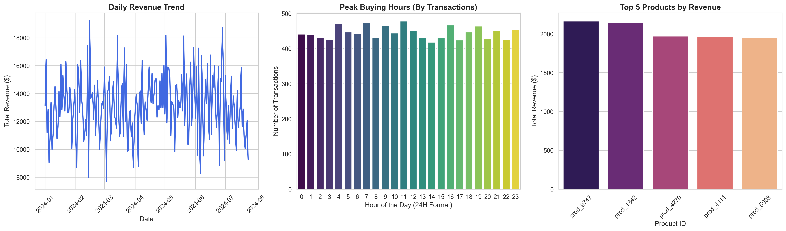

# RetailNexus: E-Commerce Big Data Pipeline 🚀

## 📌 Project Overview
RetailNexus is an end-to-end Big Data analytics pipeline built using **Apache Spark (PySpark)** and **Python**. It processes an e-commerce clickstream and transaction dataset (74,000+ rows) to extract actionable business KPIs, demonstrating data ingestion, distributed processing, Hive-style data warehousing, and automated data visualization.

## 💡 Key Business Insights & Results
By processing the massive clickstream data, this pipeline uncovered the following critical business insights:
* **Total Revenue Generated:** The platform successfully processed transactions worth **$2,704,573.00**.
* **Peak Shopping Hours:** The highest transaction volumes occur during morning hours (**11 AM, 7 AM, and 9 AM**). This indicates the optimal time window to launch targeted marketing campaigns, flash sales, and push notifications to maximize conversions.
* **Top Performing Products:** Products **`prod_9747`**, **`prod_1342`**, and **`prod_4270`** emerged as the top revenue drivers. Inventory and supply chain priority should be assigned to these items to prevent stockouts.

## 🛠️ Tech Stack
* **Engine:** Apache Spark (PySpark)
* **Language:** Python 3.8
* **Environment:** Jupyter Notebook, Windows (Compatible with JDK 11)
* **Visualization:** Matplotlib, Seaborn
* **Data Processing:** Pandas, Spark SQL

## 🏗️ Pipeline Architecture

The project is structured into 4 sequential modules:

* **Module 1: Data Ingestion**
  * Initialized a local Spark Session.
  * Ingested 74,817 rows of raw e-commerce clickstream data.
  * Inferred schema and validated data integrity.

* **Module 2: Data Processing & Analytics**
  * Cleaned data by removing duplicates and handling null values.
  * Calculated Core Business KPIs (Total Revenue, Peak Hours, Top Products).

* **Module 3: Hive Warehousing & Export**
  * Converted processed PySpark DataFrames into temporary SQL views (simulating Apache Hive).
  * Executed complex SQL queries to extract daily sales trends.
  * Exported refined dimensional data into CSV formats for dashboarding.

* **Module 4: Automated Data Visualization (Python Dashboard)**
  * Built an automated programmatic dashboard inside Jupyter using `Seaborn` and `Matplotlib`.
  * Visualized Daily Revenue Trends, Peak Transactions by Hour, and Top Products.

## 🚀 How to Run Locally
1. Clone the repository: `git clone https://github.com/goswamivishal3738a-crypto/RetailNexus.git`
2. Create a virtual environment: `python -m venv env`
3. Activate the environment: `.\env\Scripts\activate` (Windows)
4. Install dependencies: `pip install -r requirements.txt`
5. Launch Jupyter: `jupyter notebook`
6. Open `Notebooks/1_data_ingestion.ipynb` and run all cells sequentially.